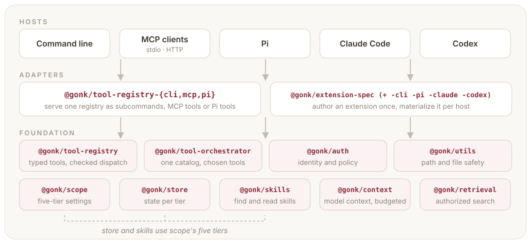

# @gonk/tool-registry-mcp

Serve a [`@gonk/tool-registry`](https://www.npmjs.com/package/@gonk/tool-registry)
registry as a [Model Context Protocol](https://modelcontextprotocol.io) (MCP)
server, over stdio or HTTP. The tools you define once become MCP tools, with
their schemas, authorization and approval rules intact. The package also works
in the other direction: it can import tools from a remote MCP server into a
registry.

It is built on the official MCP TypeScript SDK (v2). You can serve a
`ToolRegistry` directly, or an `Orchestrator` from
[`@gonk/tool-orchestrator`](https://www.npmjs.com/package/@gonk/tool-orchestrator)
when you want the model to see a smaller active set of tools.

<p align="center"></p>

## Install

```sh
npm install @gonk/tool-registry-mcp @gonk/tool-registry @gonk/auth
```

## Quick start: a stdio server

```ts
// server.ts
import { ownerPrincipal } from "@gonk/auth";
import { ToolRegistry, shape } from "@gonk/tool-registry";
import { serveMcpStdio } from "@gonk/tool-registry-mcp/stdio";

const registry = new ToolRegistry();
registry.register({
  name: "greet",
  description: "Say hello to someone.",
  input: shape<{ name: string }>(
    (value): value is { name: string } =>
      typeof value === "object" && value !== null &&
      typeof (value as { name?: unknown }).name === "string",
    "expected { name: string }",
    {
      type: "object",
      properties: { name: { type: "string" } },
      required: ["name"],
      additionalProperties: false,
    },
  ),
  approval: "read",
  handler: async ({ name }) => ({ data: { message: `Hello, ${name}!` } }),
});

serveMcpStdio({
  serverName: "greeter",
  serverVersion: "1.0.0",
  source: registry,
  instructions: "Use greet to welcome new users.",
  // A local, single-user server: every request acts as the local owner.
  makeAuthContext: () => ownerPrincipal(process.env),
});
```

Register `node server.ts` as a stdio server in any MCP client. The client sees
one tool, `greet`, with the JSON Schema above, and a call returns
`{ "message": "Hello, Ada!" }` as text and as structured content.

`instructions` is short guidance that every client receives when it connects.
If you leave it out, the registry's own `instructions` are used.

## Authorization

`makeAuthContext` is required. The server calls it for every `tools/list` and
`tools/call` request and uses the returned `AuthContext` from `@gonk/auth`:

- `tools/list` shows only the tools that the caller may discover.
- A call to a hidden tool looks the same as a call to a missing tool.
- The registry checks authorization and approval before the handler runs.

A local server for one user returns `ownerPrincipal(process.env)`. A server
with several callers builds the `AuthContext` from the authenticated request.
Never take the caller's identity from tool input.

## Write-tool policy

`writeToolPolicy` decides what happens to tools that can write: tools with
`writesFs` or `network` capabilities, or a `write` or `exec` approval tier.

| Policy | Effect |
| --- | --- |
| `"warn"` | Serve the tool and log a warning at startup. |
| `"require-allowlist"` | Refuse the tool unless its name is in `allowlist`. |
| `"permissive"` | Serve the tool without a warning. |

The default depends on the transport. `serveMcpStdio` and `createMcpServer`
default to `"warn"`. `createHttpMcpServer` and `createWebMcpHandler` default to
`"require-allowlist"`. If one process serves both, set the policy yourself.

## Serving over HTTP

`createHttpMcpServer()` serves the registry over Streamable HTTP. The
`gonk-mcp-http` command starts the same server with a built-in `gonk_health`
tool, which is useful to test a client connection.

### On this computer only (the default)

By default the server listens on `127.0.0.1`. Only programs on the same
computer can reach it, so it needs no key.

```bash
gonk-mcp-http                      # → http://127.0.0.1:8808/mcp
```

### From other machines

To accept connections from other machines, bind a network address such as
`0.0.0.0`. Then anyone who can reach the port can try to run your tools, so the
server refuses to start until you choose how callers prove access:

- **Set a key.** This is the recommended choice. Callers must send
  `Authorization: Bearer <key>`. Also list the host names that callers dial
  with `--allowed-hosts`. The server needs them for DNS-rebinding protection,
  which stops a web page from driving your server through the browser.

  ```bash
  gonk-mcp-http --host 0.0.0.0 --api-key "$(openssl rand -hex 32)" \
    --allowed-hosts "my-machine.local:8808"
  ```

- **Trust the network.** `--allow-insecure` starts the server with no key, for
  a private network where you trust every device. Anyone who can reach the port
  can run tools, and DNS-rebinding protection is off.

  ```bash
  gonk-mcp-http --host 0.0.0.0 --allow-insecure
  ```

| You want | Run |
| --- | --- |
| Local only | `gonk-mcp-http` |
| Remote, with a key | `gonk-mcp-http --host 0.0.0.0 --api-key <key> --allowed-hosts <name:port>` |
| Remote, on a trusted private network | `gonk-mcp-http --host 0.0.0.0 --allow-insecure` |

The library takes the same choices as options: `host`, `port`, `apiKey`,
`allowedHosts`, `allowInsecure` and `path`.

### Plain JSON routes

Set `jsonPath` to serve the same tools as plain JSON beside MCP. These routes
are off by default.

```ts
import type { AuthenticatedPrincipal } from "@gonk/auth";
import { GONK_AUTH_INFO_PRINCIPAL } from "@gonk/tool-registry-mcp";
import { createHttpMcpServer } from "@gonk/tool-registry-mcp/http";

const server = createHttpMcpServer({
  source: registry,
  serverName: "my-app",
  serverVersion: "1.0.0",
  jsonPath: "/tools",
  apiKey: process.env.TOOL_API_KEY,
  // The server checks the key and attaches the caller's principal to the request.
  // Your policy decides what that principal may do.
  makeAuthContext: (request) => ({
    principal: request.http?.authInfo?.extra?.[GONK_AUTH_INFO_PRINCIPAL] as AuthenticatedPrincipal,
    authorize: () => ({ outcome: "allow", reason: "any holder of the key" }),
  }),
});
await server.start();
```

- `GET /tools` returns `{ tools: [...] }` with names, descriptions, input
  schemas and annotations.
- `POST /tools/:name` takes the raw JSON input and returns
  `{ ok: true, data, ... }` or `{ ok: false, code, message, ... }`. Missing and
  hidden tools return HTTP 404.

JSON routes use the same authentication, authorization, write policy and
dispatch as MCP. MCP-only features such as sampling and elicitation are not
available on them.

## Mounting inside an existing web app

An app that already has an HTTP server can mount MCP on its own routes with
`createWebMcpHandler()`. It takes and returns Web-standard `Request` and
`Response` objects, so it works in TanStack Start, Hono, Bun and similar
frameworks.

```ts
import { GONK_AUTH_INFO_PRINCIPAL } from "@gonk/tool-registry-mcp";
import { createWebMcpHandler } from "@gonk/tool-registry-mcp/http";

const mcp = createWebMcpHandler({
  source: registry,
  serverName: "my-app",
  serverVersion: "1.0.0",
  authenticate: async (request) => {
    const session = await appAuth.verify(request);
    if (!session) return null;
    const principal = principalForSession(session); // an AuthenticatedPrincipal
    return {
      token: session.accessToken,
      clientId: session.clientId,
      scopes: [...principal.scopes],
      expiresAt: principal.expiresAt,
      extra: { [GONK_AUTH_INFO_PRINCIPAL]: principal },
    };
  },
  makeAuthContext: (request) =>
    appPolicy.authContextFor(
      request.http?.authInfo?.extra?.[GONK_AUTH_INFO_PRINCIPAL],
    ),
});

// In any framework route:
export const handle = (request: Request) => mcp.handle(request);
```

Your app validates credentials and sessions. `authenticate` returns the
normalized principal in `AuthInfo.extra`, and the principal that
`makeAuthContext` returns must be the same one. If it is not, the server logs
the mismatch and refuses the request: JSON routes answer 403, and MCP requests
get an error that says why. Each stateful MCP session stays
bound to the principal that opened it. A request from a different principal
gets the same response as an unknown session.

Points to keep in mind:

- Do not authenticate an agent-only MCP route with a browser cookie. Use a
  bearer token for the right audience, which browser scripts cannot reuse by
  accident.
- `makeContext` can add non-security host data to each call. It must not
  return `auth`.
- Without credentials the handler refuses to start unless you pass
  `allowInsecure: true`. Without `makeAuthContext` it needs
  `allowUnrestrictedTools: true`. Both are for trusted development only.
- `sessionAuditSink` receives a redacted receipt when a valid credential tries
  to reuse another principal's session.

To serve JSON routes from this handler too, set `jsonPath` and send both
`<jsonPath>` and `<jsonPath>/:name` to `mcp.handle`.

## What clients see

- With an `Orchestrator`, clients see only its active set: `always` tools and
  committed pins. With a `ToolRegistry`, they see every tool.
- Duplex tools are not served, because MCP is request and response.
- `hints.mcp.mcpName` changes the advertised name. `hints.mcp.annotations`
  become MCP hints, for example `readOnly` becomes `readOnlyHint`.
- The input schema comes from `tool.inputJsonSchema`, or from the JSON Schema
  attached with `withJsonSchema()` or `shape()`. Without one, the server
  advertises `{ "type": "object", "additionalProperties": true }`.
- `display` blocks become MCP content. Text and markdown become text, code
  becomes a fenced block, JSON is pretty-printed, images become image content,
  and links become text with the title and URL.

## Importing tools from a remote MCP server

`createMcpToolImporter()` connects to a remote MCP server and copies a reviewed
subset of its tools into your registry. Every call to an imported tool goes
through your registry's authorization first.

```ts
import { createMcpToolImporter } from "@gonk/tool-registry-mcp/client";

const importer = createMcpToolImporter({
  registry,
  serverId: "docs",
  endpoint: "https://mcp.example.com/mcp",
  allowedOrigins: ["https://mcp.example.com"],
  selection: { allow: ["search", "fetch"] },
  authorization: { requiredRole: "docs-reader" },
  approval: "read",
  resolveHeaders: async () => ({
    Authorization: `Bearer ${await secrets.get("docs-token")}`,
  }),
  overrides: {
    search: { description: "Search the product documentation." },
  },
});

await importer.connect();
```

The importer treats remote descriptions, annotations and instructions as
untrusted. Unless your configuration overrides them, imported tools get a
local description, `on-demand` visibility and the `exec` approval tier.
Credentials come from `resolveHeaders` at connect time and never appear in tool
input.

It handles paginated discovery, `tools/list_changed`, refresh, reconnect,
cancellation and timeouts. If a refresh fails, the previous complete set of
tools stays in place. It understands a small subset of JSON Schema 2020-12. A
schema that uses anything outside that subset is refused.

## Serving packaged skills

An application can ship skill folders, each with a `SKILL.md`, and serve them
through two read-only tools, `skill_list` and `skill_get`. Pass the same bundle
to this adapter to also offer them through the
[MCP Skills extension](https://skills.extensions.modelcontextprotocol.io/),
which is in beta.

```ts
import { ToolRegistry } from "@gonk/tool-registry";
import { createBundledSkillToolDefinitions } from "@gonk/skills/bundled";
import { loadMcpBundledSkills } from "@gonk/tool-registry-mcp";

const source = new ToolRegistry();
const bundledSkills = await loadMcpBundledSkills({
  root: new URL("./skills/", import.meta.url),
  createTools: createBundledSkillToolDefinitions,
});
source.register(bundledSkills.tools);
// Then pass { source, bundledSkills, ... } to serveMcpStdio or createHttpMcpServer.
```

The adapter records a digest of each file at startup and refuses to serve a
file that changed afterwards. Restart the server after you change a skill.

## Development router for many checkouts

`gonk-mcp-dev` is a small local router for development. Register its one URL
with your MCP client, then choose which checkout of your app answers new
sessions, with no change to the client's configuration. Each checkout serves
its own registry with `createHttpMcpServer`.

```json
{
  "version": 1,
  "active": "main",
  "environments": [
    {
      "id": "main",
      "repo": "./apps/example",
      "branch": "main",
      "endpoint": "http://127.0.0.1:4173/mcp",
      "database": "./.data/example.db"
    },
    {
      "id": "feature",
      "repo": "./worktrees/example-feature",
      "branch": "feature/search",
      "endpoint": "http://127.0.0.1:4179/mcp",
      "database": "./.data/example-feature.db"
    }
  ]
}
```

```bash
gonk-mcp-dev serve --config ./dev-mcp.json --port 8810
# register http://127.0.0.1:8810/mcp with the client

gonk-mcp-dev list
gonk-mcp-dev current
gonk-mcp-dev use feature
```

The router reads the file at each new MCP session. Open sessions stay on their
original checkout. Responses carry `X-Gonk-Dev-*` headers that name the active
checkout, and tools that are not marked read-only show the checkout, branch and
database in their descriptions and results.

## Protocol versions

The stdio and HTTP servers accept both the stateless `2026-07-28` MCP revision
and the earlier `initialize` handshake on the same endpoint. On the newer
revision, HTTP authenticates every request on its own. The importer tries
`2026-07-28` first and falls back to the handshake for older servers.

## Entry points

| Import | Contents |
| --- | --- |
| `@gonk/tool-registry-mcp` | `createMcpServer`, `loadMcpBundledSkills`, `GONK_AUTH_INFO_PRINCIPAL`. |
| `@gonk/tool-registry-mcp/stdio` | `serveMcpStdio`. |
| `@gonk/tool-registry-mcp/http` | `createHttpMcpServer`, `createWebMcpHandler`. |
| `@gonk/tool-registry-mcp/client` | `createMcpToolImporter`. |
| `@gonk/tool-registry-mcp/dev` | The development router. |

Commands: `gonk-mcp-http` and `gonk-mcp-dev`.

## License

Apache-2.0
