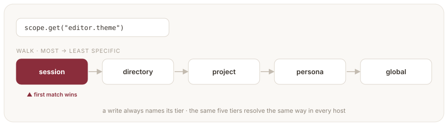

# @gonk/scope

Layered settings for agent tools. A value can be set at five tiers, and a read
returns the most specific one:

```text
session > directory > project > persona > global
```

A session override wins over a project setting, which wins over a user-wide
default, and the broader values stay in place underneath. Settings live in the
folders that agent tools already use, such as `.agents/`, `.claude/` or
`.codex/`, so one setting is visible to every tool that reads that folder.

Tools built on [`@gonk/tool-registry`](https://www.npmjs.com/package/@gonk/tool-registry)
receive a scope store as `ctx.scope`.
[`@gonk/store`](https://www.npmjs.com/package/@gonk/store) and
[`@gonk/skills`](https://www.npmjs.com/package/@gonk/skills) use the same tiers.

## Install

```sh
npm install @gonk/scope
```

## Quick start

```ts
import { FsScopeStore, ensureRoot } from "@gonk/scope/fs";
import type { ScopeEnvironment } from "@gonk/scope/types";

const env: ScopeEnvironment = { cwd: process.cwd(), sessionId: "demo-session" };

// A tier stores values in a root folder at its home. Create one where none exists yet.
ensureRoot(env, "global", ".agents");
ensureRoot(env, "session", ".agents");

const scope = new FsScopeStore(env);
scope.set("editor.theme", "dark", "global");   // a standing user preference
scope.set("editor.theme", "light", "session"); // a one-off override

scope.get("editor.theme");           // → "light" (session is the most specific tier)
scope.get("editor.theme", "global"); // → "dark"
scope.resolve("editor.theme");       // → every tier where the key is set, most specific first
```

A read with no tier walks from the most specific tier to the least specific
and returns the first match. A write always names its tier.

<p align="center"></p>

## Tiers and their homes

Each tier has a home folder:

| Tier | Home |
| --- | --- |
| `session` | `~/.agents/sessions/<sessionId>/`, or `sessionHome` |
| `directory` | The current working directory |
| `project` | The nearest folder, from the working directory up, that has `.git`, `.claude`, `.pi`, `agents`, `.agents` or `.gonk`; or `projectRoot` |
| `persona` | The active persona's folder, from `personaHome` or `resolvePersonaHome()` |
| `global` | The user's home folder, or `homeRoot` |

A tier without a home is skipped. If two tiers share a home, for example when
the working directory is the project root, only the narrower tier is used.

## Roots inside a tier

Inside a home, the store reads several known root folders, from broad to
narrow:

```text
agents/, .agents/ → .pi/ → .claude/ → .codex/ → .gemini/ → .cursor/
→ .windsurf/ → .opencode/ → .aider/ → .gonk/
```

When the same key is in two roots, the narrower root wins. A write goes to
the narrowest root that exists, or to the root you name with
`{ kind: ".claude" }`. If the tier has no root folder, the write fails, so
create one first with `ensureRoot()`. Settings are stored as YAML files.
Symbolic links are resolved, and a folder reached by two paths is read once.

## Blobs and documents

- **Blobs.** `putBlob()`, `readBlob()`, `blob()` and `deleteBlob()` store
  binary files at a tier, with the same resolution as settings.
- **Ambient documents.** `documents()` finds `AGENTS.md`, `CLAUDE.md`,
  `GEMINI.md`, `SOUL.md`, `PERSONA.md`, `AGENT.md` and `.cursorrules` at each
  tier home and inside its roots. The first three describe context; `SOUL.md`,
  `PERSONA.md` and `AGENT.md` describe a persona.

## Entry points

| Import | Contents |
| --- | --- |
| `@gonk/scope` | Everything below. |
| `@gonk/scope/types` | Types only. |
| `@gonk/scope/fs` | `FsScopeStore`, `createScope`, `ensureRoot`, `StandardRootAdapter`. |
| `@gonk/scope/memory` | `MemoryScopeStore`, an in-memory store for tests, with no file system dependencies. |
| `@gonk/scope/resolver` | `findProjectRoot`, `bindRoots`, `scanDocuments` and related helpers. |

## License

Apache-2.0
