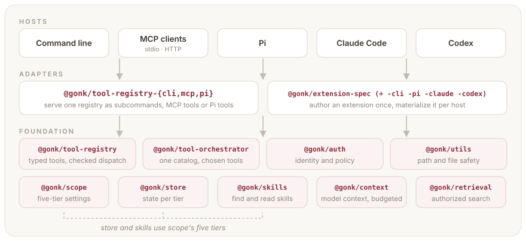

# @gonk/tool-registry

Define an agent tool once and run it in any host. A tool is a typed handler
with a validated input schema and a declared approval tier. The registry
validates input, checks authorization and approval, and dispatches the call.

The same registry is served by the host adapters:
[`@gonk/tool-registry-mcp`](https://www.npmjs.com/package/@gonk/tool-registry-mcp)
for MCP (stdio and HTTP),
[`@gonk/tool-registry-cli`](https://www.npmjs.com/package/@gonk/tool-registry-cli)
for a command line, and
[`@gonk/tool-registry-pi`](https://www.npmjs.com/package/@gonk/tool-registry-pi)
for Pi agents. Identity and policy types come from
[`@gonk/auth`](https://www.npmjs.com/package/@gonk/auth).

<p align="center"></p>

## Install

```sh
npm install @gonk/tool-registry @gonk/auth
```

## Quick start

```ts
import { ownerPrincipal } from "@gonk/auth";
import {
  ToolRegistry,
  collectToolOutcome,
  makeBaseContext,
  shape,
} from "@gonk/tool-registry";

const registry = new ToolRegistry();

registry.register({
  name: "greet",
  description: "Say hello to someone.",
  input: shape<{ name: string }>(
    (value): value is { name: string } =>
      typeof value === "object" && value !== null &&
      typeof (value as { name?: unknown }).name === "string",
    "expected { name: string }",
    {
      type: "object",
      properties: { name: { type: "string", minLength: 1 } },
      required: ["name"],
      additionalProperties: false,
    },
  ),
  approval: "read",
  handler: async ({ name }) => ({ data: { message: `Hello, ${name}!` } }),
});

// A single-user host binds one local owner identity.
const auth = ownerPrincipal(process.env);

const outcome = await collectToolOutcome(
  registry.invoke("greet", { name: "Ada" }, makeBaseContext({ auth })),
);
// → { ok: true, data: { message: "Hello, Ada!" } }

await collectToolOutcome(
  registry.invoke("greet", { nom: "Ada" }, makeBaseContext({ auth })),
);
// → { ok: false, code: "INVALID_INPUT", ... }
```

To serve this registry to an MCP client, pass it to `serveMcpStdio` from
`@gonk/tool-registry-mcp/stdio`.

## Defining a tool

```ts
interface ToolDefinition<I, O> {
  name: string;
  description: string;
  input: StandardSchemaV1<unknown, I>;
  output?: StandardSchemaV1<unknown, O>;
  approval?: "read" | "write" | "exec" | { tier, override?, reason? } | ((input) => ...);
  handler: (input: I, ctx: ToolContext) => Promise<ToolResult<O>> | AsyncIterable<ToolEvent<O>>;
  visibility?: "always" | "on-demand";
  category?: string;
  tags?: string[];
  keywords?: string[];
  capabilities?: { readsFs?, writesFs?, network?, longRunning?, idempotent?, duplex? };
  hints?: { cli?, mcp?, pi? };
  requires?: () => boolean;
  // and more: inputJsonSchema, validateOutput, lifecycle, composition, cost, latency
}
```

- **Input schema.** `input` is any [Standard Schema](https://standardschema.dev)
  value, so Zod, Valibot and ArkType schemas work directly. Adapters advertise a
  JSON Schema to clients. Attach it to the same value with
  `withJsonSchema(schema, jsonSchema)`, or use `shape(check, message,
  jsonSchema)` for a small hand-written check. Without one, adapters advertise
  an open object.
- **Approval tier.** `read`, `write` or `exec` says how dangerous the tool is.
  A missing or malformed declaration counts as `exec`, the most restrictive
  tier. A function can pick the tier from the call's input.
- **Visibility.** `always` tools are shown to the model at all times.
  `on-demand` tools are found and loaded through
  [`@gonk/tool-orchestrator`](https://www.npmjs.com/package/@gonk/tool-orchestrator).
- **Host hints.** `hints.mcp`, `hints.cli` and `hints.pi` adjust names,
  annotations and visibility for one host only.
- **Conditional registration.** If `requires()` returns `false`,
  `register()` skips the tool. Use it to gate a tool on configuration, for
  example `requires: () => Boolean(process.env.SEARCH_API_KEY)`.

`register()` accepts one definition or an array.

## The handler context

Every handler receives a `ToolContext`:

| Field | What it is |
| --- | --- |
| `signal` | An `AbortSignal` that the adapter fires on cancellation. |
| `log` | A structured logger. Tools log here, not to stdout or stderr. |
| `cwd`, `env` | The working directory and environment of the call. |
| `auth` | The caller's identity and authorization policy (`AuthContext`). |
| `invoke(name, input)` | Calls another tool through the same checked dispatch path. |
| `callStack` | The names of the tools on the current call stack. |
| `scope` | Optional five-tier settings store from [`@gonk/scope`](https://www.npmjs.com/package/@gonk/scope). |
| `input` | Optional input stream for duplex tools, such as audio. |

`makeBaseContext({ auth, ...overrides })` fills in defaults for the rest.

## Results and streaming

A handler returns `{ data, display?, metadata? }`, or yields a stream of
events:

```ts
type ToolEvent =
  | { type: "log"; level; message; meta? }
  | { type: "progress"; percent?; message? }
  | { type: "data"; chunk }
  | { type: "result"; data; display?; metadata? }
  | { type: "error"; code; message; details? };
```

`registry.invoke()` always returns this event stream. `collectToolOutcome()`
reduces it to `{ ok: true, data, ... }` or `{ ok: false, code, message, ... }`.
`display` holds blocks that hosts render natively: text, markdown, code, JSON,
images and links.

## Authorization and approval

Every call carries an `AuthContext`. There is no anonymous fallback: the
registry refuses to run a tool without one. A single-user host, such as a local
CLI or a personal MCP server, uses `ownerPrincipal(process.env)` from
`@gonk/auth`. A host with several callers builds one `AuthContext` per verified
caller.

To avoid passing `auth` on every call, bind it once:

```ts
const bound = registry.withPrincipal(ownerPrincipal(process.env));
```

For each call, the registry does these steps in order:

1. It authorizes `tool.discover`, so a hidden tool and a missing tool give the
   same result.
2. It validates the input.
3. It resolves the application resource that the tool declares, if any.
4. It authorizes `tool.invoke`.
5. It asks the configured `ApprovalProvider` about `write` and `exec` tools.
6. It writes redacted authorization and approval receipts to the audit sink.
7. It runs the handler only if every step allowed the call.

Tools called through `ctx.invoke()` keep the original caller and are checked
again. A call that needs approval ends with an `APPROVAL_REQUIRED` error that
carries structured details. The registry never holds a request open while a
person decides.

```ts
const registry = new ToolRegistry({
  security: {
    approvalProvider,      // decides write and exec calls
    resourceResolver,      // resolves resources that tools declare
    auditSink,             // receives redacted receipts
    mandatoryAudit: true,
  },
});
```

With no `approvalProvider`, `write` and `exec` tools fail with
`APPROVAL_DENIED`. A host that asks for consent in its own way sets
`security.approvalMode: "bypass"`.

## Other ways to call a registry

- **Typed client.** `createClient(tools, transport)` builds a client whose
  methods take their input and output types from the tool definitions, with no
  code generation. Keep the tools in a `const` tuple with `defineTools()`. A
  tool named `notes.search` becomes `client.notesSearch(input)`.
- **WebSocket.** `makeWsHandler()` serves request and reply over a WebSocket
  emitter that you provide, and can broadcast the results of writes. The host
  supplies `authorize(tool, caller, input)` and builds the `ToolContext` for
  each caller.

## Result metadata, lifecycle and composition

A result can carry a `metadata` envelope: where the data came from, how fresh
it is, its cache policy, and whether it was truncated. A truncated result must
include a continuation cursor or an artifact reference.
`projectToolResultReceipt(metadata)` gives a copy that is safe for audit logs.

A definition can declare `lifecycle` (for example, `deprecated` or
`superseded` with a replacement) and `composition` (what it consumes and
produces). Hosts show this in tool descriptions. A deprecated tool stays
callable, and calls to a superseded tool are never redirected.

## Long-running tools

`dispatchDetachedWithWait()` from `@gonk/tool-registry/async-dispatch` helps
with tools that take minutes. By default the tool starts a detached job and
returns a job handle at once. The caller can pass `wait: true` to block for the
result instead. You supply the functions that start the job, run it inline and
render each result.

## Entry points

| Import | Contents |
| --- | --- |
| `@gonk/tool-registry` | Everything below. |
| `@gonk/tool-registry/types` | Types only. |
| `@gonk/tool-registry/contracts` | Client-safe types and pure functions, for UI code. |
| `@gonk/tool-registry/registry` | `ToolRegistry`, `makeBaseContext`. |
| `@gonk/tool-registry/shape` | `shape`, `passthrough`. |
| `@gonk/tool-registry/json-schema` | `withJsonSchema`, `resolveInputJsonSchema`. |
| `@gonk/tool-registry/errors` | `ToolError`, `ERROR_CODES`. |
| `@gonk/tool-registry/approval` | `resolveApproval` and tier helpers. |
| `@gonk/tool-registry/security` | `ApprovalProvider`, `ToolResourceResolver` and related types. |
| `@gonk/tool-registry/outcome` | `collectToolOutcome`. |
| `@gonk/tool-registry/metrics` | Invocation metrics sinks. |
| `@gonk/tool-registry/receipt` | `projectToolResultReceipt`. |
| `@gonk/tool-registry/lifecycle` | Lifecycle description helpers. |
| `@gonk/tool-registry/async-dispatch` | `dispatchDetachedWithWait`. |

More examples, including authenticated writes and mounting MCP inside a web
app, are in the
[tool authoring guide](https://github.com/nightwork-dev/gonk/blob/main/docs/tool-authoring.md).

## License

Apache-2.0
